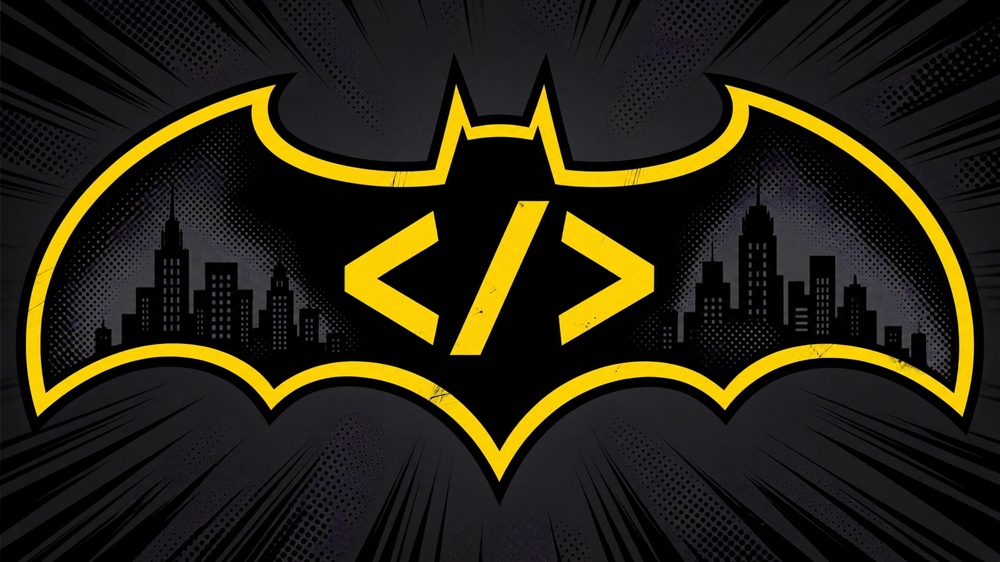

# Batman

**Evidence over assumptions.**



Evidence-driven engineering skills for investigating bugs, designing resilient solutions, and checking whether changes achieve the intended outcome.

Batman starts with what must happen, follows the relevant system, and supports conclusions with source, logs, or actual checks. Reviews examine requirements, unchanged callers, and existing helpers alongside the diff. Plans account for credible failures and recovery. Challenges test whether a simpler approach meets the same need.

For example, a retry fix may pass its tests yet still duplicate a payment after a timeout. Batman asks whether the failure sequence is covered, whether an existing helper already handles it, and what evidence supports the conclusion.

Each skill works on its own. There is no runtime dependency: it uses the coding agent's existing tools and permissions.

## Choose a skill

| Skill | Use it for |
| --- | --- |
| [batman-investigate](skills/batman-investigate/SKILL.md) | Reconstruct the failure and test competing explanations |
| [batman-design](skills/batman-design/SKILL.md) | Plan for the required outcome, credible failures, and recovery |
| [batman-challenge](skills/batman-challenge/SKILL.md) | Question assumptions and complexity without dropping requirements |
| [batman-review](skills/batman-review/SKILL.md) | Check the outcome, affected behavior, and opportunities for reuse |
| [batman-execute](skills/batman-execute/SKILL.md) | Implement the smallest complete change and verify its behavior |

Use a focused skill directly:

```text
Use $batman-review to review this branch against the ticket.
Use $batman-investigate to find why these requests time out.
Use $batman-execute to fix the retry bug and check the affected callers.
```

`$batman` selects a skill from the task. Quick, Standard, and Deep requests control how far it explores. Evidence matters at every depth.

Batman takes inspiration from [Ponytail](https://github.com/DietrichGebert/ponytail/tree/main/skills): short instructions, plain words, and the smallest change that finishes the job. Reviews read the diff first, then the ticket and requirements, then relevant source code and tests as needed. Findings need concrete evidence, including affected behavior outside the diff.

## Use without installing

Clone this repository, then give your coding agent the absolute path of a skill:

```sh
git clone https://github.com/smhimran/batman.git
cd batman
```

```text
Read /absolute/path/to/batman/skills/batman-review/SKILL.md and use it to review this branch.
```

The root `SKILL.md` provides the Batman selector. The installable skills live in `skills/`.

## Optional project installation

Install the five skills and the Batman selector into an existing project:

```sh
python3 scripts/install.py --host codex --project /absolute/path/to/project
python3 scripts/install.py --host codex --project /absolute/path/to/project --check
```

Choose `--host codex`, `--host claude`, or `--host both`:

| Host | Installation directory | Example invocation |
| --- | --- | --- |
| Codex | `.agents/skills/batman-*/` and `.agents/skills/batman/` | `$batman-review` |
| Claude Code | `.claude/skills/batman-*/` and `.claude/skills/batman/` | `/batman-review` |

The installer includes skill instructions, agent metadata, and the license. It excludes evaluations, tests, and scripts. It checks all destinations before writing. Identical copies stay unchanged; differing copies and symlinked destinations are preserved and reported as conflicts. To replace a conflicting copy, back it up and remove it before reinstalling.

`--check` verifies copied contents, not host discovery or execution.

## How the skills work

- Establish success independently of the proposed implementation.
- Trace behavior beyond changed files; test explanations against contrary evidence.
- Reuse existing code after checking its behavior and failure handling against the requirement.
- Plan safeguards and recovery for credible risks, proportional to their impact.
- State what the evidence demonstrates and what remains unverified. Stop when the question is settled.

These instructions guide the agent's work; they cannot guarantee correctness or prevent every failure. A clean diff or passing test suite alone does not establish that the user's goal was reached.

Reviews, investigations, proposals, and plans stay read-only unless changes are requested. An implementation request authorizes work within its scope. The skills grant no extra permission to post, deploy, or publish.

## What the benchmarks show

The [15 November benchmark report](evals/reports/2026-11-15-investigation.md) compares the current skills with the previous snapshot and fresh comparator runs: **80 completed trials, zero execution failures**, ten development fixtures, two repetitions, requested `gpt-6-sol`, and medium reasoning.

| Review approach | Rubric score / 100 | Median reported tokens |
| --- | ---: | ---: |
| Batman | 100.0 | 96,575 |
| Previous Batman snapshot | 100.0 | 94,805.5 |
| Plain Codex | 86.7 | 85,351 |
| Superpowers reviewer template on Codex | 100.0 | 87,079 |
| Codex built-in reviewer | 100.0 | Unavailable |

| Broader tasks | Rubric score / 100 | Median reported tokens |
| --- | ---: | ---: |
| Batman | 100.0 | 106,631.5 |
| Previous Batman snapshot | 93.3 | 105,197 |
| Plain Codex | 100.0 | 61,501.5 |

Batman met every rubric criterion in all 20 of its trials. The previous snapshot's two investigation deductions concerned requesting traces without also requesting health evidence. Both updated responses distinguished locating the delay from confirming its cause and requested corroborating health data. Reviews retained their 100.0 score in this matched run.

This was **not a token-saving result**: Batman used about **13% more review tokens than plain Codex**, **11% more than the Superpowers template**, and **73% more on broader tasks than plain Codex**. Plain-Codex review deductions concerned omitted repair recommendations, so the review score difference is not evidence of unique bug discoveries. The rubric measures required outcomes and repair completeness, not bug detection alone.

One automated skill-read flag was inspected: a native-review command searched for skill filenames without reading a skill. The report records that audit and the limits of the command heuristic.

Reported tokens include cached input and are not subscription charges. Native review usage counters were unavailable. These are small, author-controlled development fixtures with model-assisted grading, not independent real-world benchmarks. They do not establish general superiority, statistical significance, or a population false-positive rate. Superpowers means its pinned reviewer template on Codex, not its full orchestration framework. Authenticated Claude Code execution was not compared.

The [14 November report](evals/reports/2026-11-14-updates.md) and [8 November report](evals/reports/2026-11-08-diff-first.md) preserve earlier results. See [validation task limitations](evals/validation/KNOWN_LIMITATIONS.md) for synthetic task provenance and the ambiguous cache control. Raw trial bundles are excluded from Git and must be shared separately for a complete trace audit.

## Development and evaluation

Run the offline checks from the repository root with Python 3 and Node.js:

```sh
python3 -m unittest discover -s tests -v
node --test tests/test_prompts.cjs
```

These check packaging, installation behavior, source-only workspace preparation, fixture behavior, prompt parity, and benchmark reporting. They do not establish model reasoning quality.

Prepare an isolated source-only task:

```sh
python3 evals/prepare.py list
python3 evals/prepare.py prepare hidden-regression /tmp/batman-trial-a
```

The destination must be new and its parent must exist. The helper prints the task separately and refuses to overwrite an existing workspace.

Run the full behavioral comparison from a terminal without opening the Codex desktop app:

```sh
python3 scripts/benchmark.py
```

This uses the installed, signed-in Codex CLI and saves a timestamped report and evidence in `evals/results/`. It can resume interrupted runs. See the [benchmark guide](evals/benchmark/README.md) for options, prerequisites, and the alternative Promptfoo workflow. **No API key is required for this harness.** The separate snapshot evaluation in [evaluation methodology](evals/METHODOLOGY.md) uses configured provider credentials and measures reasoning over supplied context rather than tool use.

Freeze skills, tasks, settings, and grading criteria before execution. Keep grader answers outside evaluated workspaces, disable global discovery that could contaminate comparisons, audit actual traces, and count execution failures. Model-assisted grades need review; completion is not a quality score.

## Repository guide

| Path | Purpose |
| --- | --- |
| [`SKILL.md`](SKILL.md) | Batman selector entry point |
| [`skills/`](skills/) | Five standalone skills and the Batman selector |
| [`agents/`](agents/) | Batman selector metadata |
| [`scripts/install.py`](scripts/install.py) | Optional project-local installer |
| [`examples/`](examples/) | Workflow and communication examples |
| [`tests/`](tests/) | Offline behavioral and packaging checks |
| [`evals/benchmark/`](evals/benchmark/) | Authenticated CLI comparison harness |
| [`evals/scenarios/`](evals/scenarios/) | Ten development fixtures |
| [`evals/validation/`](evals/validation/) | Additional synthetic tasks, ground truth, and validity notes |
| [`evals/reports/`](evals/reports/) | Results, audits, and limitations |

## Contributing

Prefer concise instructions that change an engineering decision over longer checklists. Explain the observed failure behind a proposed rule, preserve uncertainty and useful repair guidance, and add behavioral coverage where it helps. Keep expected answers separate from evaluated context and label synthetic or author-created tasks honestly.

Run the offline checks and report behavioral trials with their actual limits. Do not optimize instructions for grader keywords, change grading to manufacture a win, or claim verification that did not run.

## License

[MIT](LICENSE).
